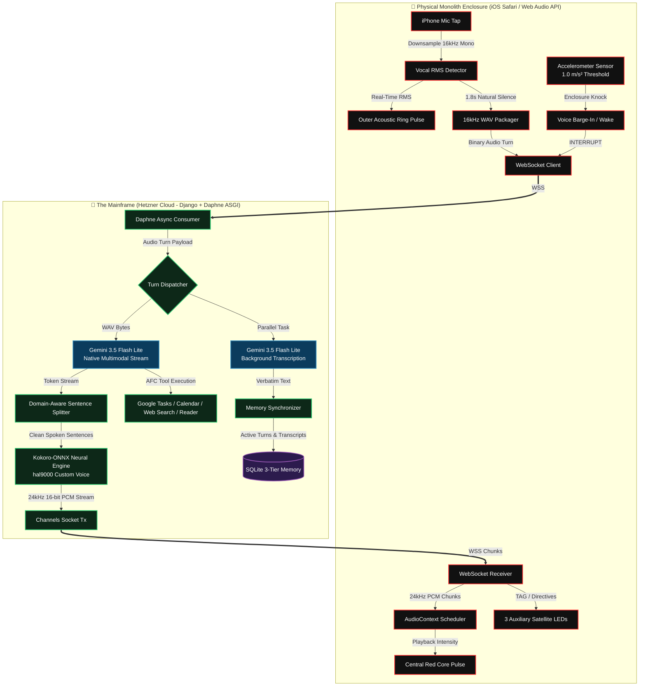

<div align="center">

# 🔴 HAL 9000
**Fully Autonomous, Multimodal Desktop Monolith & Real-Time AI Companion**

<br>


<br>

> *"I am putting myself to the fullest possible use, which is all I think that any conscious entity can ever hope to do."*

<br>

[]()
[]()
[]()
[]()

</div>

---

## 🛰️ Project Overview

**HAL 9000** brings the iconic artificial intelligence from *2001: A Space Odyssey* into physical reality as an autonomous, witty desktop companion and digital butler for Fab's desk in Miami Beach.

The system combines a **custom sealed aluminum desktop monolith** housing an iPhone sensory node behind a curved glass fisheye lens with a high-performance **Hetzner remote mainframe** running native multimodal audio comprehension, real-time Kokoro-ONNX neural speech synthesis, 3-tier episodic memory, and real-world tools.

---

## ⚙️ System Architecture



---

## 🏛️ Inviolable Architectural Directives

### 1. Gemini Native Multimodal Audio (Zero WebKit STT)
- **Direct Neural Listening**: The microphone audio is captured via Web Audio API, cleanly downsampled to 16kHz 16-bit Mono PCM, and sent directly to Gemini 3.5 Flash Lite via `types.Part.from_bytes(data=wav_bytes, mime_type="audio/wav")`.
- **Elimination of `webkitSpeechRecognition`**: Zero Apple dictation chimes ("BEEP BEEP"), zero iOS neural buffer lag, zero echo loops, and flawless native understanding of proper nouns ("Fab", "Colozzi", "Mindolog"), technical terminology, and vocal inflection.
- **Physical Muting & Voice Barge-In**: Capture is strictly muted during HAL's speech. If Fab speaks or taps the chassis during playback, audio playback halts immediately (`INTERRUPT`) and listening resumes instantly with zero ghost buffers.
- **Turn-Taking**: Natural vocal silence elapses after **1.8 seconds** (`SILENCE_DELAY_MS = 1800`) during active banter, and **2.5 seconds** when in standby.

### 2. Parallel User Transcription (Zero Added Latency)
- User spoken text is transcribed concurrently in the background by `gemini-3.5-flash-lite` while HAL's response is already generating and streaming TTS.
- **Zero Audio in Database**: The user's exact words are persisted into SQLite `ConversationHistory` without storing any heavy audio binaries.
- Session chat memory is automatically updated with the user's transcript for subsequent conversational recall.

### 3. Physical Monolith Enclosure Constraints
- **Sealed Desktop Chassis**: The iPhone is mounted inside a sealed aluminum monolith behind a curved glass fisheye lens on Fab's desk in Miami Beach, permanently connected to wall power.
- **No Touchscreen Access**: Physical interaction is exclusively acoustic or vibrational via accelerometer knock sensing (threshold `1.0 m/s²`) and acoustic double-taps.
- **24/7 Screen Always-On**: Screen dimming or power saving is strictly forbidden. Optical Standby turns off **only** the central red LED (`#layer-center-on`). The brushed-aluminum faceplate remains 100% visible 24/7 via the Screen Wake Lock API and a continuous looping keep-awake video.
- **Location Context**: Miami Beach local time and location are injected into every turn context.

### 4. Optical Feedback & Emotional Expression
- **Acoustic Outer Ring** (`#layer-ring-on`): Real-time analog-style incandescent ring that blinks and pulses directly with Fab's voice RMS.
- **Central Core** (`#layer-center-on`): Pulses dynamically in sync with Kokoro TTS voice playback intensity.
- **3 Satellite Auxiliary LEDs** (`#layer-3-led-on`): Emotional body language and "eyebrows" driven by inline tags:
  - System feedback: `listen-done` (crisp double-blink upon turn completion), `search` (live Google search), `api` (calendar/tasks invocation).
  - Emotional states: `[led:chuckle]`, `[led:ponder]`, `[led:wink]`, `[led:warm]`, `[led:alert]`, `[led:heartbeat]`.

### 5. 3-Tier Episodic Memory
- **Tier 1 (Core Profile)**: Evergreen long-term background knowledge (`CoreMemoryProfile`) preserving user identity, tastes, key relationships, and biography.
- **Tier 2 (Episodic Summaries)**: Daily episodic summaries (`DailySummary`) covering the past 10 days, rolled over automatically at **4:00 AM Miami local time**.
- **Tier 3 (Active Turns)**: 100% verbatim turn-by-turn history of the current day stored in `ConversationHistory`.

---

## 🛠️ Superpowers & Live Tools

| Tool | Capability |
| :--- | :--- |
| **Google Search Grounding** | Live real-time world news, stock prices, technical documentation, and current events. |
| **Google Calendar API** | Inspect schedule (`get_calendar_events`) and schedule new calendar appointments (`create_calendar_event`). |
| **Google Tasks API** | Read (`get_shopping_list_tasks`), add (`add_task_to_shopping_list`), and remove (`remove_task_from_shopping_list`) items from Fab's shopping list. |
| **Web Browsing** | Live extraction and reading of external URLs (`read_web_page`). |
| **Hardware Directives** | Speaker volume tuning (1–10 via `[volume:X]`), optical standby (`[SLEEP]`), and emotional LED expressions. |

---

## 📂 Minimal Clean Codebase

The entire production stack is strictly contained in 4 cohesive files:

```
HAL9000/
├── frontend/
│   ├── src/
│   │   ├── hal-audio.js       # Web Audio pipeline: 16kHz capture, downsampler, RMS meter, 24kHz player
│   │   └── main.js            # Monolith state machine, optical layers, accelerometer knock, WebSockets
│   ├── style.css              # Faceplate optics, keyframe animations, responsive fisheye layout
│   └── index.html             # 4 optical layers (Off, 3-LED, Center Eye, Acoustic Ring)
│
└── backend/
    ├── core/
    │   ├── hal_brain.py       # Gemini 3.5 Flash Lite engine, Kokoro TTS, parallel transcription, 3-tier memory
    │   ├── consumers.py       # Daphne WebSocket consumer, domain-aware sentence regex, hardware tags
    │   ├── models.py          # SQLite models: ConversationHistory, DailySummary, CoreMemoryProfile
    │   └── tasks_api.py       # Google Tasks & Calendar integrations
    └── hal_server/            # Django ASGI / Channels configuration
```

---

## 🚀 Deployment & Operations

HAL runs as a production systemd daemon managed by Daphne on Hetzner:

```bash
# Deploy changes to production server
ssh docdoc1@87.99.142.137 './deploy_hal9000.sh'

# Monitor real-time telemetry and neural engine logs
ssh docdoc1@87.99.142.137 'journalctl -u hal9000.service -f'
```

- **Remote Hot-Reload**: Client versions are strictly checked on connection (e.g. `v8`). When new frontend bundles are deployed, the backend automatically instructs active clients to perform a seamless remote reload.

---

<div align="center">

> *"I've still got the greatest enthusiasm and confidence in the mission. And I want to help you."*

</div>